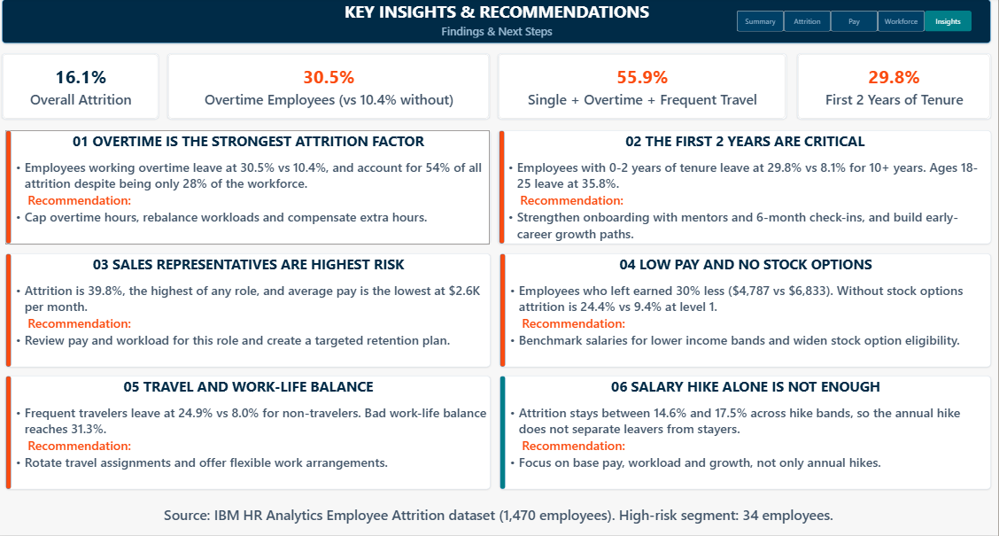
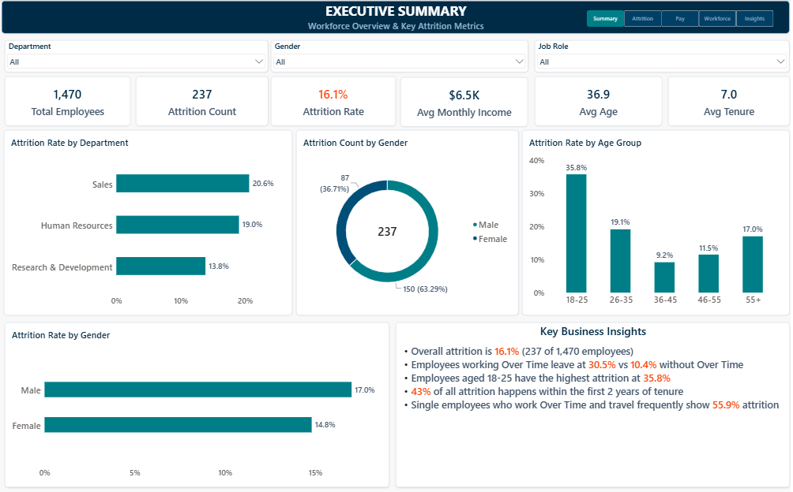
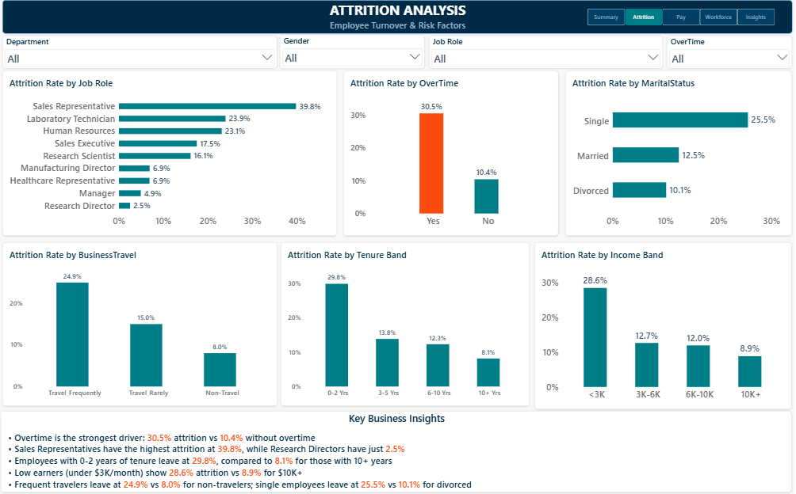
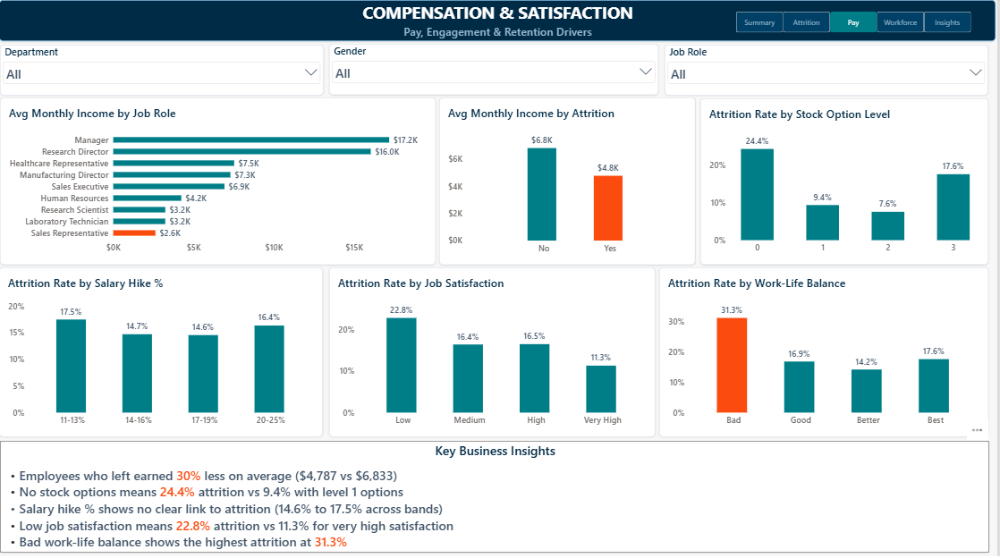
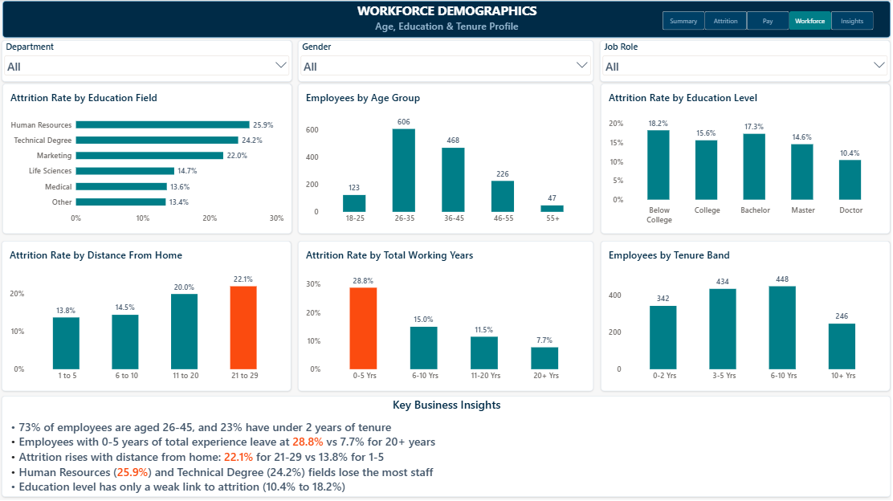

<div align="center">

# HR Analytics: Employee Attrition Dashboard

### Understanding who leaves, and why, across 1,470 employees


<br>



</div>

---

## Table of Contents

1. [Project Overview](#project-overview)
2. [Key Findings at a Glance](#key-findings-at-a-glance)
3. [Dataset](#dataset)
4. [Tools and Skills](#tools-and-skills)
5. [Project Workflow](#project-workflow)
6. [Dashboard Walkthrough](#dashboard-walkthrough)
7. [Insights and Recommendations](#insights-and-recommendations)
8. [DAX Measures](#dax-measures)
9. [Repository Structure](#repository-structure)
10. [How to Open the Dashboard](#how-to-open-the-dashboard)
11. [Limitations and Next Steps](#limitations-and-next-steps)
12. [Author](#author)

---

## Project Overview

Employee attrition is costly: it drains experience, raises hiring and training costs, and disrupts teams. This project builds an interactive **five-page Power BI dashboard** on the IBM HR Analytics Employee Attrition dataset to answer three questions:

- **How big is the attrition problem?**
- **Who is leaving?** (roles, age groups, work conditions)
- **Which factors are associated with leaving?** (overtime, pay, tenure, travel, satisfaction)

The dashboard ends with clear insights and practical recommendations that an HR manager can act on.

> **Full written report:** [`report/IBM_HR_Analytics_Dashboard_Report.pdf`](report/IBM_HR_Analytics_Dashboard_Report.pdf) (13 pages)

---

## Key Findings at a Glance

| Metric | Value |
|---|---|
| Overall attrition | **16.1%** (237 of 1,470 employees) |
| Attrition among employees working overtime | **30.5%** (vs 10.4% without overtime) |
| Attrition in the first 2 years of tenure | **29.8%** (vs 8.1% for 10+ years) |
| Highest-risk role: Sales Representative | **39.8%** |
| Single + overtime + frequent travel | **55.9%** (19 of 34 employees) |

---

## Dataset

| Item | Detail |
|---|---|
| Source | IBM HR Analytics Employee Attrition and Performance dataset |
| Size | 1,470 employee records, 35 original columns |
| Data quality | No missing values, no duplicate rows |
| Target field | `Attrition` (Yes / No): 237 Yes and 1,233 No |
| Field groups | Demographics, job and role, compensation, satisfaction ratings, tenure and experience, travel and overtime |

Raw file: [`data/IBM_HR_Analytics_Raw_Data.csv`](data/IBM_HR_Analytics_Raw_Data.csv)

---

## Tools and Skills

| Tool | Used for |
|---|---|
| **Microsoft Excel** | Data cleaning, helper columns (bands and labels), PivotTable validation |
| **Power BI Desktop** | Data modeling, DAX measures, interactive dashboard design |
| **DAX** | Attrition rate, retention rate, average income, tenure and segment-level measures |

**Skills demonstrated:** data cleaning, feature engineering (bands and flags), DAX, data modeling, dashboard design, KPI storytelling, business insight writing.

---

## Project Workflow

**1. Prepare (Excel)**
- Saved the CSV as an Excel workbook and converted it into a table named `HR_Data`.
- Removed 6 columns that add no value: `EmployeeCount`, `StandardHours`, `Over18` (constant values) and `DailyRate`, `HourlyRate`, `MonthlyRate` (no clear business meaning).
- Added 17 helper columns: `Attrition Flag`, bands (Age, Income, Tenure, Salary Hike, Distance, Experience), readable labels (Education, Job Satisfaction, Environment Satisfaction, Work-Life Balance) and sort columns.
- Validated with PivotTables: 237 attrition cases, 1,470 employees, 16.1% overall, overtime 30.5% vs 10.4%.

**2. Model (Power BI)**
- Loaded `HR_Data`, set data types, and used *Sort by column* so bands display in logical order.
- Created a dedicated `_Measures` table for all DAX measures.

**3. Visualize**
- Designed five pages with a consistent navy, teal and coral palette, a shared page navigator and synced slicers (Department, Gender, Job Role).

**4. Interpret**
- Converted the findings into six insights, each with a recommended action.

<details>
<summary><b>Excel helper column formulas (click to expand)</b></summary>

<br>

| Column | Formula |
|---|---|
| Attrition Flag | `=IF([@Attrition]="Yes",1,0)` |
| Age Group | `=IF([@Age]<=25,"18-25",IF([@Age]<=35,"26-35",IF([@Age]<=45,"36-45",IF([@Age]<=55,"46-55","55+"))))` |
| Income Band | `=IF([@MonthlyIncome]<3000,"<3K",IF([@MonthlyIncome]<6000,"3K-6K",IF([@MonthlyIncome]<10000,"6K-10K","10K+")))` |
| Tenure Band | `=IF([@YearsAtCompany]<=2,"0-2 Yrs",IF([@YearsAtCompany]<=5,"3-5 Yrs",IF([@YearsAtCompany]<=10,"6-10 Yrs","10+ Yrs")))` |
| Hike Band | `=IF([@PercentSalaryHike]<=13,"11-13%",IF([@PercentSalaryHike]<=16,"14-16%",IF([@PercentSalaryHike]<=19,"17-19%","20-25%")))` |
| Distance Band | `=IF([@DistanceFromHome]<=5,"1 to 5",IF([@DistanceFromHome]<=10,"6 to 10",IF([@DistanceFromHome]<=20,"11 to 20","21 to 29")))` |
| Experience Band | `=IF([@TotalWorkingYears]<=5,"0-5 Yrs",IF([@TotalWorkingYears]<=10,"6-10 Yrs",IF([@TotalWorkingYears]<=20,"11-20 Yrs","20+ Yrs")))` |
| Education Level | `=CHOOSE([@Education],"Below College","College","Bachelor","Master","Doctor")` |
| Job Satisfaction Level | `=CHOOSE([@JobSatisfaction],"Low","Medium","High","Very High")` |
| Env Satisfaction Level | `=CHOOSE([@EnvironmentSatisfaction],"Low","Medium","High","Very High")` |
| WorkLife Balance Level | `=CHOOSE([@WorkLifeBalance],"Bad","Good","Better","Best")` |

Each band also has a numeric *Sort* column (1, 2, 3, 4) used with Power BI's *Sort by column*.

</details>

---

## Dashboard Walkthrough

The dashboard follows a top-down story: overall picture, who is leaving, pay and satisfaction, workforce profile, and finally insights and actions. Every page shares the same title bar, page navigator and slicers.

### Page 1: Executive Summary



- 1,470 employees, 237 left: overall attrition of **16.1%**.
- Sales has the highest department attrition (**20.6%**) versus Research and Development (13.8%).
- Employees aged **18-25** leave most often (35.8%).
- Gender has a smaller effect: 17.0% (male) vs 14.8% (female).

### Page 2: Attrition Analysis



- **Overtime:** 30.5% vs 10.4%, the largest gap of any single factor.
- **Job role:** Sales Representative (39.8%), Laboratory Technician (23.9%), Human Resources (23.1%).
- **Marital status:** Single 25.5% vs Divorced 10.1%.
- **Travel:** frequent travelers 24.9% vs non-travelers 8.0%.
- **Tenure and income:** 0-2 years of tenure 29.8%; income below $3K 28.6%.

### Page 3: Compensation and Satisfaction



- Employees who left earned **$4.8K** on average vs **$6.8K** for those who stayed (about 30% less).
- **Stock options:** 24.4% attrition with none vs 9.4% at level 1.
- **Salary hike %:** no clear pattern (14.6% to 17.5% across bands).
- **Work-life balance:** "Bad" shows the highest attrition at **31.3%**.

### Page 4: Workforce Demographics



- About **73%** of employees are aged 26-45.
- Employees with 0-5 years of total experience leave at **28.8%** vs 7.7% for 20+ years.
- Attrition rises with distance from home: 13.8% (closest) to **22.1%** (farthest).
- Education level has only a weak link to attrition (10.4% to 18.2%).

### Page 5: Key Insights and Recommendations

The page shown at the top of this README. It combines four headline metrics and six insight cards, each with evidence and a recommended action (full table in the next section). The screenshot is also available at [`screenshots/05_Key_Insights.png`](screenshots/05_Key_Insights.png).

---

## Insights and Recommendations

| # | Insight | Evidence | Recommendation |
|---|---|---|---|
| 1 | **Overtime has the strongest link to attrition** | 30.5% vs 10.4%; overtime employees are 28% of staff but 54% of leavers | Cap overtime hours, rebalance workloads, compensate extra hours |
| 2 | **The first 2 years are critical** | 29.8% for 0-2 years vs 8.1% for 10+ years; ages 18-25 leave at 35.8% | Strengthen onboarding with mentors and 6-month check-ins; build early-career growth paths |
| 3 | **Sales Representatives are highest risk** | 39.8% attrition and the lowest average pay ($2.6K per month) | Review pay and workload; create a targeted retention plan |
| 4 | **Low pay and no stock options** | Leavers earned 30% less; no stock options 24.4% vs 9.4% at level 1 | Benchmark salaries for lower bands; widen stock option eligibility |
| 5 | **Travel and work-life balance** | Frequent travel 24.9% vs 8.0%; bad work-life balance 31.3% | Rotate travel assignments; offer flexible work |
| 6 | **Salary hike alone is not enough** | 14.6% to 17.5% across hike bands | Focus on base pay, workload and growth, not only annual hikes |

> **Priority segment:** employees who are single, work overtime and travel frequently show 55.9% attrition (19 of 34). The group is small, so treat it as a signal, not a precise rate.

---

## DAX Measures

```DAX
Total Employees = COUNTROWS(HR_Data)

Attrition Count = SUM(HR_Data[Attrition Flag])

Attrition Rate = DIVIDE([Attrition Count], [Total Employees])

Retention Rate = 1 - [Attrition Rate]

Avg Monthly Income = AVERAGE(HR_Data[MonthlyIncome])

Avg Age = AVERAGE(HR_Data[Age])

Avg Tenure = AVERAGE(HR_Data[YearsAtCompany])

OT Attrition Rate = CALCULATE([Attrition Rate], HR_Data[OverTime] = "Yes")

Non OT Attrition Rate = CALCULATE([Attrition Rate], HR_Data[OverTime] = "No")

Early Tenure Attrition Rate = CALCULATE([Attrition Rate], HR_Data[YearsAtCompany] <= 2)

High Risk Attrition Rate =
CALCULATE(
    [Attrition Rate],
    HR_Data[MaritalStatus] = "Single",
    HR_Data[OverTime] = "Yes",
    HR_Data[BusinessTravel] = "Travel_Frequently"
)

High Risk Employees =
CALCULATE(
    [Total Employees],
    HR_Data[MaritalStatus] = "Single",
    HR_Data[OverTime] = "Yes",
    HR_Data[BusinessTravel] = "Travel_Frequently"
)
```

---

## Repository Structure

```
IBM-HR-Analytics-Dashboard/
├── data/
│   └── IBM_HR_Analytics_Raw_Data.csv
├── excel/
│   └── IBM_HR_Analytics_Cleaned_Data.xlsx
├── powerbi/
│   └── IBM_HR_Analytics_Dashboard.pbix
├── screenshots/
│   ├── 01_Executive_Summary.png
│   ├── 02_Attrition_Analysis.png
│   ├── 03_Compensation_Satisfaction.png
│   ├── 04_Workforce_Demographics.png
│   └── 05_Key_Insights.png
├── report/
│   ├── IBM_HR_Analytics_Dashboard_Report.pdf
│   └── IBM_HR_Analytics_Dashboard_Export.pdf
└── README.md
```

---

## How to Open the Dashboard

1. Download [`powerbi/IBM_HR_Analytics_Dashboard.pbix`](powerbi/IBM_HR_Analytics_Dashboard.pbix) and the Excel file from the `excel/` folder.
2. Open the `.pbix` in **Power BI Desktop** (free).
3. If Power BI shows a data source error, go to **Home → Transform data → Data source settings**, choose **Change Source**, and point it to the downloaded Excel file.
4. Click **Refresh**. In Power BI Desktop, use **Ctrl + Click** on the page navigator to switch pages.

---

## Limitations and Next Steps

**Limitations**
- **Association, not causation:** the dashboard shows which factors are linked to attrition, not that they caused it.
- **Fictional dataset:** the IBM dataset is created for illustration, so the work demonstrates method rather than conclusions about a real company.
- **Small groups:** some segments (for example the 34-employee high-risk group) are small, so their rates can swing widely.
- **No dates:** it is a snapshot, so trends over time cannot be analyzed.

**Next steps**
- Test the strongest factors together (for example logistic regression).
- Add an attrition risk score to flag at-risk employees early.
- Add a drill-through page per job role.
- Publish to Power BI Service for interactive sharing.

---

## Author

**Syed Ubedullah Basha**
Data Analyst | Power BI Developer | SQL Developer

[](https://linkedin.com/in/syed-ubedullah-basha)
[](https://github.com/syed-ubedullah)
[](mailto:syedubedullahbasha@gmail.com)

*September 2026*

---

<div align="center">

If you found this project useful, consider giving it a star.

</div>
